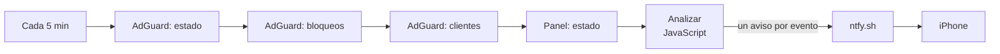

# Alertas de la red al móvil

n8n revisa AdGuard Home y el panel cada 5 minutos y me manda un aviso al iPhone con [ntfy](https://ntfy.sh) cuando pasa algo.

## Qué avisa

| Aviso | Cuándo | Prioridad |
|---|---|---|
| Web peligrosa bloqueada | Un dispositivo consulta un dominio de malware, phishing o estafa | Alta |
| Dispositivo nuevo en la red | Aparece una IP de la LAN que AdGuard no había visto | Alta |
| Servicio caído | AdGuard o el panel dejan de responder, o la protección se desactiva | Urgente |
| Servicio recuperado | Vuelve a responder (con los minutos que estuvo caído) | Normal |
| Posible intento de saltarse el filtro | Un dispositivo intenta usar un DNS cifrado externo o una VPN (lista HaGeZi DoH/VPN/Proxy bypass) | Alta |
| Resumen diario (22:00) | Consultas, bloqueos y amenazas de 24 h, uso aproximado de apps por dispositivo y número total de visitas a webs +18 | Baja |

## Cómo decide qué es peligroso

Un bloqueo cuenta como amenaza si lo ha parado la navegación segura de AdGuard o una de estas listas:

- HaGeZi Threat Intelligence Feeds
- Phishing URL Blocklist (PhishTank y OpenPhish)
- Malicious URL Blocklist (URLHaus)
- Scam Blocklist (DurableNapkin)

Los bloqueos de publicidad y rastreadores no avisan: serían cientos al día.

## Resumen diario y uso de apps

Cada noche n8n descarga las últimas 24 h del registro de AdGuard y calcula:

- **Uso aproximado de apps** (TikTok, Instagram, YouTube, Discord, Roblox, Fortnite, PlayStation, Steam...): cuenta las franjas de 5 minutos en las que un dispositivo hace al menos 3 consultas a los dominios de esa app. Los dominios salen de la lista de servicios de AdGuard. Es una estimación: el tráfico de fondo de algunas apps puede sumar minutos.
- **Webs +18**: solo un número total para toda la casa, sin decir qué dispositivo ni qué web. Compara cada consulta con la lista NSFW de HaGeZi. No bloquea nada.

## Cortar una app desde el móvil

El resumen trae botones para cortar 1 hora las tres apps más usadas del día. Al pulsarlo, ntfy llama a un webhook de n8n que:

1. Añade la app a los servicios bloqueados de AdGuard (en toda la casa).
2. Avisa al móvil con la hora a la que volverá.
3. Espera el tiempo indicado, la quita de la lista y vuelve a avisar.

El botón solo funciona con el móvil en la wifi de casa o conectado por Tailscale. La dirección del webhook lleva un texto aleatorio para que no se pueda adivinar.

## Para no recibir spam

- El flujo guarda entre ejecuciones (`$getWorkflowStaticData`) la hora del último bloqueo revisado, los dispositivos conocidos y qué servicios estaban caídos.
- El mismo dispositivo y dominio solo avisa una vez por hora.
- Como mucho 5 avisos de amenazas por ejecución; el resto se resume en uno.
- La primera ejecución solo aprende: no avisa de lo que ya había.

## Montarlo

1. Copiar `services/n8n/workflows/config.example.json` a `config.json` y rellenarlo (IP del NAS, tema de ntfy, texto aleatorio para el webhook e ids de las listas de AdGuard).
2. `python3 services/n8n/workflows/build.py config.json <carpeta>` genera `red-alertas.json`, `red-resumen.json` y `red-cortar-app.json`.
3. En n8n: importar los tres JSON y crear una credencial *Basic Auth* llamada `AdGuard Home`.
4. En el móvil: app ntfy → suscribirse al tema.

El tema de ntfy y la dirección del webhook funcionan como contraseñas: por eso `config.json` no está en el repositorio.

## Privacidad

Toda la familia sabe que el DNS de casa registra las consultas. Los avisos en tiempo real son solo de seguridad (amenazas, dispositivos nuevos, intentos de saltarse el filtro). Las webs +18 solo aparecen como un número total anónimo en el resumen.
