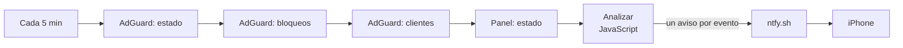

# Alertas de la red al móvil

n8n revisa AdGuard Home y el panel cada 5 minutos y me manda un aviso al iPhone con [ntfy](https://ntfy.sh) cuando pasa algo.

## Qué avisa

| Aviso | Cuándo | Prioridad |
|---|---|---|
| Web peligrosa bloqueada | Un dispositivo consulta un dominio de malware, phishing o estafa | Alta |
| Dispositivo nuevo en la red | Aparece una IP de la LAN que AdGuard no había visto | Alta |
| Servicio caído | AdGuard o el panel dejan de responder, o la protección se desactiva | Urgente |
| Servicio recuperado | Vuelve a responder (con los minutos que estuvo caído) | Normal |
| Resumen diario (22:00) | Consultas, bloqueos, amenazas y dispositivo más activo | Baja |

## Cómo decide qué es peligroso

Un bloqueo cuenta como amenaza si lo ha parado la navegación segura de AdGuard o una de estas listas:

- HaGeZi Threat Intelligence Feeds
- Phishing URL Blocklist (PhishTank y OpenPhish)
- Malicious URL Blocklist (URLHaus)
- Scam Blocklist (DurableNapkin)

Los bloqueos de publicidad y rastreadores no avisan: serían cientos al día.

## Para no recibir spam

- El flujo guarda entre ejecuciones (`$getWorkflowStaticData`) la hora del último bloqueo revisado, los dispositivos conocidos y qué servicios estaban caídos.
- El mismo dispositivo y dominio solo avisa una vez por hora.
- Como mucho 5 avisos de amenazas por ejecución; el resto se resume en uno.
- La primera ejecución solo aprende: no avisa de lo que ya había.

## Montarlo

1. `python3 services/n8n/workflows/build.py <IP_NAS> <tema_ntfy> <carpeta> '[ids de las listas]'` genera `red-alertas.json` y `red-resumen.json`.
2. En n8n: importar los dos JSON y crear una credencial *Basic Auth* llamada `AdGuard Home`.
3. En el móvil: app ntfy → suscribirse al tema.

El tema de ntfy funciona como contraseña: quien lo conozca puede leer los avisos. Por eso no está en el repositorio.
