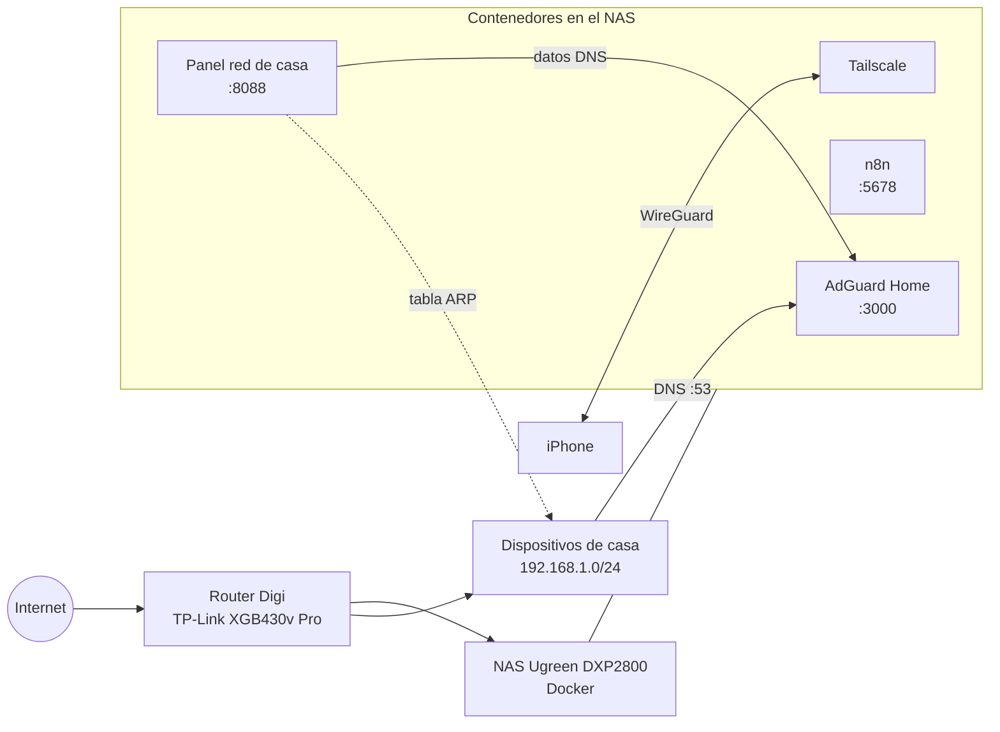

# Red y acceso

## Puertos

| Servicio | Puerto | Red |
|---|---|---|
| AdGuard Home (DNS) | 53 TCP/UDP | host |
| AdGuard Home (panel) | 3000 | host |
| Panel red de casa | 8088 | host |
| n8n | 5678 | bridge |
| Panel del NAS (UGOS) | 9999 | — |

## Acceso desde fuera

Solo por Tailscale. El router no tiene ningún puerto abierto.

- **Exit node:** el móvil puede salir a Internet por la conexión de casa, útil en wifis públicas.
- **Subnet router:** desde el móvil se llega a cualquier IP de la red de casa (192.168.1.0/24), no solo al NAS.

## Por qué `network_mode: host`

- **AdGuard** necesita escuchar en el puerto 53 del NAS y ver la IP real de cada dispositivo; con la red bridge de Docker todas las consultas llegarían desde la misma IP.
- **El panel** lee la tabla ARP del NAS para relacionar cada IP con la MAC del dispositivo.
- **Tailscale** necesita gestionar rutas e interfaces del host para hacer de exit node y subnet router.
