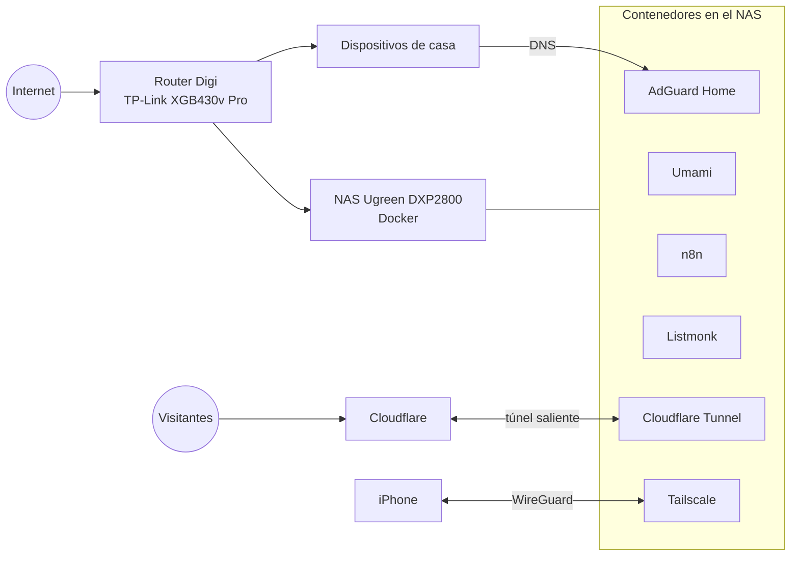

# Red y acceso

## Dos formas de entrar desde fuera

| Vía | Para qué | Puertos abiertos en el router |
|---|---|---|
| Cloudflare Tunnel | Servicios públicos (Umami, webhooks de n8n, Listmonk) con HTTPS | Ninguno: el túnel sale desde el NAS |
| Tailscale | Acceso privado mío al panel del NAS y a la red de casa | Ninguno: conexión WireGuard punto a punto |

## Por qué así

- **Sin puertos abiertos.** El router no expone nada a Internet; se reduce la superficie de ataque.
- **Exit node.** Con Tailscale el móvil puede salir a Internet por la conexión de casa, útil en wifis públicas.
- **Un compose por servicio.** Cada servicio se levanta, actualiza o borra por separado sin tocar los demás.
- **Secretos fuera del repo.** Cada carpeta usa un `.env` local que no se sube; en el repo solo está `.env.example`.
